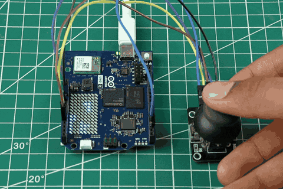

# Arduino UNO Q Tetris App

Tetris for the Arduino UNO Q, played on the onboard 8x13 LED matrix with an analog joystick. Built with AI agent mode in Arduino App Lab.

> Full build article: **[Arduino UNO Q Getting Started](https://circuitdigest.com/microcontroller-projects/arduino-uno-q-getting-started)**

## Hardware

- Arduino UNO Q
- 2-axis analog joystick module with push button
- 5 jumper wires

| Joystick | UNO Q |
|----------|-------|
| VRx      | A0    |
| VRy      | A1    |
| SW       | D2    |
| VCC      | 3.3V (or 5V) |
| GND      | GND   |

## Install

1. Download `led-matrix-tetris.zip` from the [Releases page](../../releases/latest).
2. In Arduino App Lab, choose **Import App** and select the zip.
3. Wire the joystick, connect the UNO Q, press **Run**.

Import fails? Clone this repo and copy the `led-matrix-tetris` folder (the one containing `app.yaml`) to `/home/arduino/ArduinoApps/` on the board. It then appears under **My Apps**.

> Don't use GitHub's **Code > Download ZIP** for import. It nests the app inside the repo folder, so App Lab won't recognise it.

Tested with: App Lab **[VERSION]**, UNO Q **[BOARD/OS VERSION]**.

## Controls

| Input | Action |
|-------|--------|
| Stick left / right | Move piece |
| Stick up | Rotate |
| Stick down (hold) | Soft drop |
| Press stick button | Hard drop |
| Button or stick up on game over | Restart |

Speed increases with score. Cleared lines flash before disappearing.

## Tuning

The whole game runs in the MCU sketch (`led-matrix-tetris/sketch/`); `python/main.py` only keeps the app alive.

- Left/right or up/down backwards? Flip `INVERT_X` / `INVERT_Y` in `sketch/joystick.cpp`.
- Piece drifts on its own? Raise `DEADZONE` in `sketch/joystick.cpp`.
- Picture rotated for your viewing angle? Set `DISPLAY_ORIENTATION` in `sketch/display.h`.

## How it was made

Generated and iterated with the AI agent mode in Arduino App Lab, then reviewed and tested on hardware.

## License

[MIT](LICENSE). Source files carry Arduino's MPL-2.0 SPDX headers from the App Lab template.
